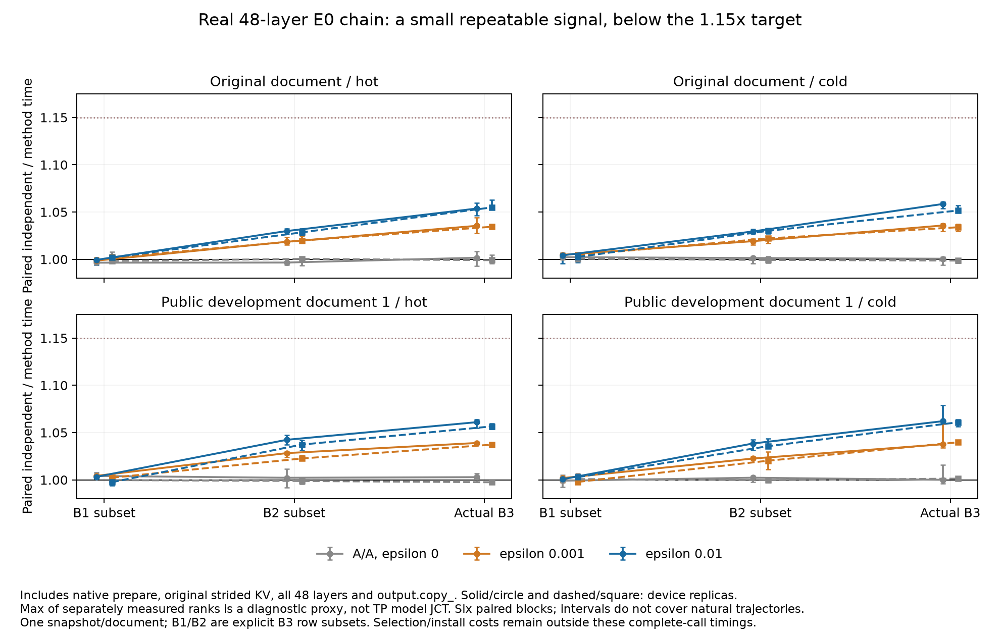

# 真实 48 层同 E0 检查：保留小收益，停止当前应用扩展

2026-10-16。四个 TP2 作业同时使用八张 RTX 5090，全部成功，总分配
**0.3092982453 P1 GPUh**，低于事前含清理上限 0.4 GPUh。普通用户、项目虚拟环境，
没有 root 操作。[冻结协议](../../configs/joint_real48_replay_protocol_v1.json)、
[作业配置](../../configs/joint_real48_replay_jobs_v1.json)、[原始完整性](raw_validation.json)。

**结论：改变支持集确实产生了小幅、可重复的本地执行收益，但没有通过原定
1.15× 完整调用或同质量 5% 应用净改善的推进要求；停止当前 joint-E0 自然生成扩跑。**
这不证明所有联合选择算法都无用，也不把现有负结果视为已经完成论文要求。

使用当前生产栈 Torch 2.13 / vLLM 0.31 / FlashInfer 0.7.0.post1，保持 32K
每请求预算、全部 48 层原始 strided KV 和实际 private tail。每文档在两卡对重复，
共两文档。真实第七个 B3 decode dispatch 内保存 Q、页表、位置和 attention 输出；
冻结后不再执行模型或写 KV。B3 重放输出及 live indices 均逐位匹配实际最后一步。
B1/B2 仅取这一 B3 状态的前一/二行，不能称独立自然 survivor 轨迹。

四个支持集版本共享一组已捕获 E0 图及地址，显式安装等长历史并验证 plan topology。
每变体、每 B、每层均与自己的同 mask SIMT 参考比较，**4608/4608 检查通过**；
epsilon0 另与 independent 逐位匹配。完整调用包含 native prepare、GPU 全层索引映射、
48 次 attention 及生产 `output.copy_`。选择和安装成本另列，没有藏入免费准备。

每格六个随机顺序 block 加精确反序；hot 三次、cold 一次，先取格内中位数，按 block
成簇 bootstrap 10000 次。共 4608 测量行、9216 次调用，均非独立文档样本。
[完整统计/CSV](analysis/summary.json)、[逐格 CSV](analysis/paired.csv)。
两个 rank 没有逐 sample barrier；下表是分别测量后取 max 的组合代理，**不是实测 TP2 JCT**。

| 实际 B3：含 prepare 的同步 host 完整调用 | independent / 方法速度比范围 | 每 48 层步配对节省范围 |
| --- | ---: | ---: |
| epsilon0 A/A | 0.99743–1.00285 | −5.32–5.84 μs |
| epsilon0.001 | 1.03391–1.03972 | 70.14–79.22 μs |
| epsilon0.01 | 1.05160–1.06205 | 105.00–120.74 μs |

范围覆盖两文档、两设备副本、hot/cold 八格，没有合并成单一总体速度估计。
B1 的 1% 版本接近 1，B2 收益介于两者之间。所有 B3 1% 完整调用置信区间上限
也低于 1.15。图中保留 A/A、设备差异、全部 cache 条件和原推进线。

每配置 `max_rank(CPU finalize + score D2H)` 为 2.8133–2.9255 秒；没有扣掉
epsilon0 的人为验证成本，也没有把所有 epsilon 的准备全算给单个方法。
按 B3 实测节省作条件外推，1% 版本回本需 **24024–27021 个批量步**。
已知 independent E0 的两文档 B3 共活上限仅 1138/1774 步。甚至将 B3 收益错误地
乐观延续至最后一个请求退出，毛节省仍仅约 0.12–0.48 秒。这只是偏向继续的
敏感性情景，不是新轨迹测量或严格硬件上界；尚未加额外安装/RPC 增量。
[摊销输入及全部情景](analysis/conditional_amortization.json)。

实际完整模型四个 B3 step 的 trace 另作归因。每 rank 精确识别 192 个 native
primary、192 个 merge 和 192 个必需 output-copy；其余 4 个同名 copy 没有误算。
八 rank 共 1536 个必需 copy 全部匹配。FI 加 copy 时间占仪器化模型 CUDA 事件区间
约 20.62%–24.62%；kernel-duration sum、同四图 kernel sum 的分母分别保留。
该比率不是关键路径加速上界，也不能把纯 attention 链当作含 MoE/NCCL 的模型。
[归因及逐节点证据](trace_attribution.json)、[CPU 复算脚本](../../scripts/summarize_joint_replay_trace.py)。

当前没有任务质量、源 KV 释放或新算法主张。经典 cover 在此前几何比较中更强，
本次仅为交换法的有界终止诊断，不能用缺少 cover 的全层结果宣称方法优越。
原始失败、其它预算、历史观察窗变体和先前小幅正向结果均保留。
