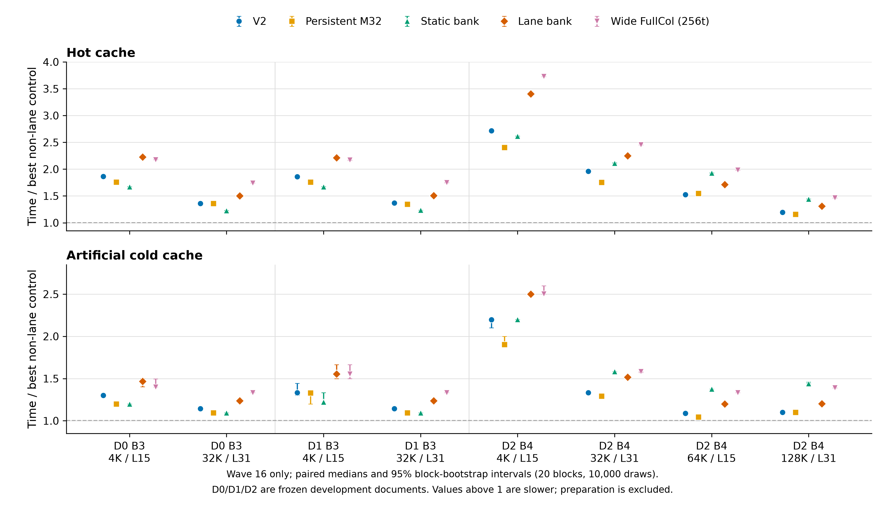

# Wave16 lane/wide comparison: independent audit and paired figure

2026-10-16. All eight jobs ended normally. This CPU-only audit reads the
wave16 results, frozen captures and allocation ledger; it executes no attention,
compiles no kernel, initializes no CUDA and modifies no original experiment.

```bash
CUDA_VISIBLE_DEVICES='' .venv/bin/python scripts/audit_operator_lane_wave16.py
CUDA_VISIBLE_DEVICES='' .venv/bin/python scripts/plot_operator_lane_wave16.py
```

[Audit JSON](audit.json) contains every source/capture hash, selected parameter,
ledger terminal, original paired comparison and directly recomputed figure data.

## Independent checks

- **568/568 configurations**, zero recorded numerical/configuration failures:
  four B3 states × 55 and four B4 states × 87. Frozen FP64 O/LSE assertions are
  unchanged; this CPU audit verifies recorded successes, not a new attention run.
- Independent partition/tree and parameter enumeration exactly matches each
  55/87 configuration set, retaining baseline, guard, FullCol, persistent and
  two-point bankpilot controls. Lane adds six S32/S64/S128 × N32/N64 points;
  wide FullCol adds three N64/split32/64/128 points at **256 threads**.
- Static v4 is strengthened to four qualified of six split/N points: B3 S64/S128
  at both N; B4 S64 at both N plus S32/N32 and S128/N64. It is not a full grid.
- Every dynamic `candidate_name` explicitly matches its thread count, including
  default 128 versus wide 256. Candidate identities cannot collapse the two.
  Protocol, all source/per-candidate hashes and progress/final JSON agree.
- **52 capture-file SHA256 values** match prior frozen source/overlay receipts.
  Document, rank0, measured-ready, prefix and full private-suffix identities agree.
- Every selected winner reproduces as its complete eligible tuning minimum.
  `best_lane_control` excludes only lane, thus includes wide, the strengthened
  v4, persistent, FullCol, v2/v3 and native/fixed/tree. Actual selected control
  families in this wave are E0, E1 and E4.
- All 16 hot/cold cells retain 20 random/reverse blocks and all 19 measured
  method/alias identities. All medians and **352 original paired ratios/95%
  intervals** reproduce using 10,000 block-bootstrap draws. Preparation and
  amortization arithmetic reproduce. Five method/control time ratios and CIs
  are separately recomputed directly from raw paired readings for the figure,
  yielding 80 plotted observations; no cross-wave winners are assembled.
- All eight allocation costs are retained: **0.26232246326567193 P2 GPU-hours**,
  including initialization/JIT/planning. Audit and plotting consume zero GPU-hours.

## Result within this wave

The table uses paired `method time / best_lane_control time`; above 1 is slower:

| Method | Hot range | Artificial-cold range |
| --- | ---: | ---: |
| V2 | 1.195–2.716× | 1.089–2.198× |
| Persistent M32 | 1.160–2.406× | 1.044–1.902× |
| Static bank v4 | 1.227–2.617× | 1.095–2.200× |
| Lane bank | 1.311–3.406× | 1.200–2.500× |
| Wide FullCol, 256 threads | 1.466–3.729× | 1.333–2.504× |

**Neither lane nor wide wins against the strongest non-lane control in any of
16 cells**. All their time-ratio interval lower endpoints exceed 1; the same is
true for the other three plotted methods. This conclusion follows from the
raw within-wave paired measurements, not from prior-wave summaries.

## Figure and provenance



Publication files: [PNG](paired_time_ratios.png), [vector PDF](paired_time_ratios.pdf).
The [figure receipt](figure_receipt.json) records the audit/plotter/output hashes
and all 80 plotted estimates/intervals. Both panels use only wave16; the dashed
reference is 1. Hot and artificial-cold have labeled separate scales. D0 is
`docfinqa256`, D1 `publicdev1_256`, D2 `publicdev6_256`; document source SHA values
and exact case order are in the audit. English labels avoid font substitution.

The figure reports complete GPU producer+merge and required packing/restoration,
excluding one-time CPU preparation and host synchronized complete-call wall.
Artificial cold flushing occurs outside the event. Tuning remains a bounded,
per-capture oracle; static v4/lane grids differ, and fixed-M32 persistence changes
masked MMA/softmax work. Five-reading matched tuning is not final paired inference.
Repeated layers/budgets/blocks are not independent documents. No application,
answer quality, energy, hardware-traffic or actual TP2 critical-path gain follows.
